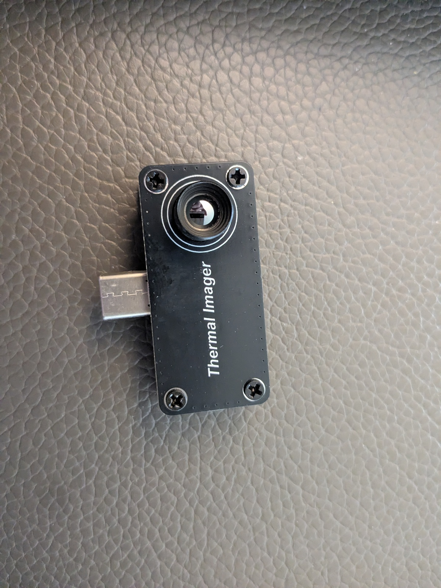
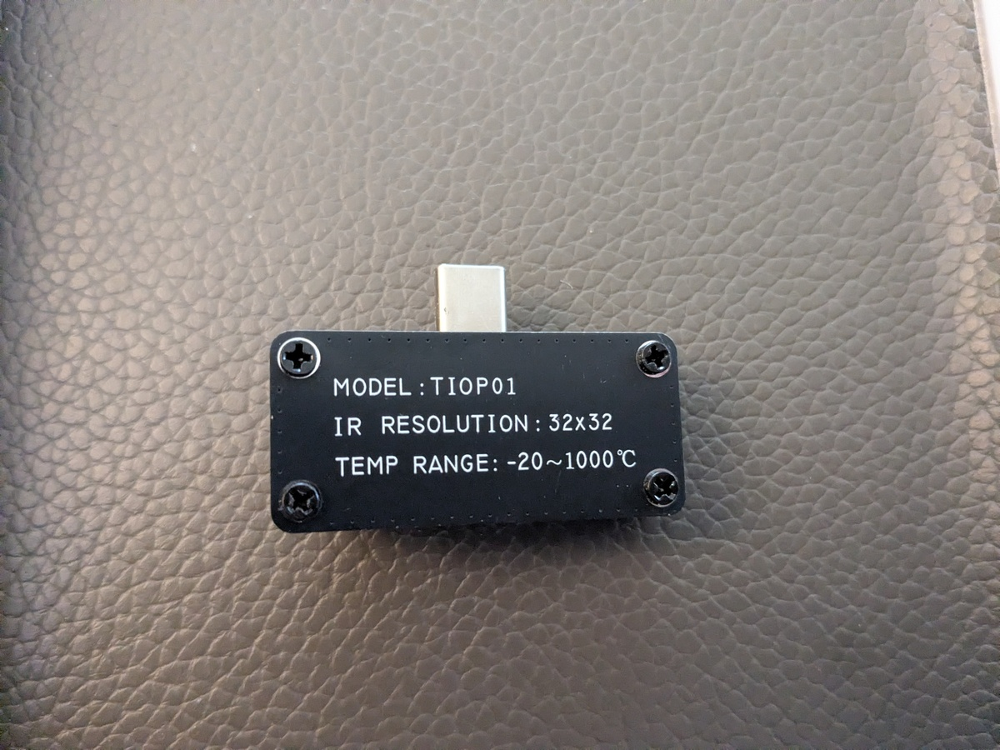

# thermalview-usb

**Live demo (Web Serial, Chrome/Edge):** https://butzist.github.io/ThermalView/

Python driver for the **ThermalView** USB thermal adapter
(`com.ruiqi.hongwai`, 32×32 sensor, CH340-class USB-serial bridge) on Linux.

The protocol was reconstructed from the Android app's `TempData.java` and the
native `libhongwai.so` JNI decoder.  See `TODO.md` for the evidence trail.

## Install

Everything is provided by the Nix dev shell:

```sh
nix develop
python -m thermalview info
```

For a normal environment:

```sh
pip install -e .
```

## Quick start

```sh
# list candidate adapters
python -m thermalview ports

# read one frame, print stats and save an 800x800 PNG
python -m thermalview capture --png frame.png

# live stats (Ctrl-C to stop)
python -m thermalview stream

# live web viewer (opens a browser, no GUI toolkit required)
python -m thermalview view

# record the raw serial stream for later analysis
python -m thermalview capture --count 30 --record out/session.bin

# decode a capture offline
python -m thermalview decode out/session.bin --index 5 --png frame5.png --npy frame5.npy

# set scene emissivity
python -m thermalview emissivity 0.95
```

Python API:

```python
from thermalview import ThermalCamera, save_frame

with ThermalCamera() as camera:      # auto-detects the single adapter
    frame = camera.read_frame()
    print(frame.stats())
    print(frame.celsius.shape)       # (32, 32) float32 degrees Celsius
    save_frame(frame, "frame.png", palette="iron_red")
```

## Protocol summary

USB-serial, **115200 8N1**, RTS + DTR asserted.

Commands (`00 80 <cmd> 00 <len_lo> <len_hi> [payload]`):

| cmd | meaning | payload |
|-----|---------|---------|
| `0x03` | set emissivity | one byte, `round(e * 100)` |
| `0x04` | start stream | — |
| `0x05` | stop stream | — |

The app never sends `0x04`; the adapter streams as soon as the port opens.

Incoming frames:

```
00 80 01 00 ?? ??           6-byte header
<2048 bytes little-endian>  1024 x uint16
```

Each sample is **tenths of a degree Celsius**: `T = raw / 10.0`.

Some firmware variants (e.g. the Espressif CDC build) stream raw 2048-byte
frames with no `00 80` header; the driver auto-detects this mode.
`TempData` also handles `00 90` status packets (subtype `4`/`5` = start/stop
ack); the parser reports them as `StatusEvent`.

Axis options are applied per pixel: X mirrors each 32-pixel row, Y flips the
image vertically.

## Palettes

The native app has five palettes, exposed by index (`color_type`):

| index | name |
|-------|------|
| 0 | `iron_red` |
| 1 | `rainbow` (stepped) |
| 2 | `white_hot` |
| 3 | `blue_orange` |
| 4 | `blue_yellow` |

`thermalview.palette` reproduces the native functions exactly (including
integer truncation) and maps a Celsius array to RGB.

## Notes and caveats

- Reconstructed statically; validate against your unit with
  `python -m thermalview capture --record out/first.bin`.
- The Android renderer adds a **+1 °C** hot-spot bias to pixels above a
  median-derived threshold before computing max/min, and auto-ranges with
  `max *= 1.5` when the range is below 6 °C.  `FrameStats` reports honest
  values; `frame_to_rgb(..., app_auto_range=True)` reproduces the range rule.
- The app's custom prober registers `1a86:7522` as FTDI, but its USB device
  filter and the default prober point at `1a86:7523` (CH340).  The driver
  accepts both plus FTDI/CP210x/PL2303 alternatives.
- `/dev/ttyUSB*` must be visible inside the sandbox; see `.envrc`
  (`JAIL_EXTRA_ARGS`). Only the serial tty nodes and `/dev/serial` are bound —
  never the whole `/dev`.

## Tests

```sh
nix develop -c pytest
```

---

## Device: TIOP01 "Thermal Imager"

- Model name on the unit / listings: **TIOP01** ("Thermal Imager", "32×32 IR
  Sensor For Android").
- Vendor/brand is not printed on the device; the Android app package is
  `com.ruiqi.hongwai` ("ruiqi" / 瑞奇, "hongwai" = infrared). Sold as a
  white-label OEM part on AliExpress / Amazon / eBay / Banggood.
- Search terms that find it: `TIOP01 thermal imager`, `USB-C thermal camera
  32x32 Android`, `32x32 IR sensor type-c`.
- Example listings:
  - AliExpress: https://de.aliexpress.com/item/1005002147937157.html
  - Amazon: https://www.amazon.com/Portable-20-1000%E2%84%83-temperature-detection-inspection/dp/B0F6CZM1CJ
  - Banggood manual (PDF): http://myosuploads3.banggood.com/products/20240628/20240628051138TIOP01UserManuaL.pdf
- Specs: 32×32 (1024 px), -20..1000 °C, USB-C, Android 8–12 (app),
  ~44×29×19 mm, 10 g. The sensor is an ESP32-class CDC-ACM device
  (`303a:4001`), not the CH340 (`1a86:7523`) the original app targets.
- The original APK was downloaded from
  https://gitee.com/hubo-998/hongwai/raw/master/ThermalViewPro.apk
  (kept out of this repository).




## Android app

A minimal Android app is provided under `android/` and a pre-built, debug-signed
APK is attached to the
[latest release](https://github.com/butzist/ThermalView/releases/latest).
It opens the adapter with `usb-serial-for-android`, reads 32×32 frames and
renders them. Install with:

```sh
adb install ThermalView.apk
```

To build from source you need the Android SDK (platform 37, build-tools 37) and
the `usb-serial-for-android` AAR; see `android/`.

## Reverse-engineering process

This repository is the result of a static + dynamic reverse-engineering effort
on the ThermalView Android app (`com.ruiqi.hongwai`, v1.1, code 1, minSdk 21,
targetSdk 34) and its native library `lib/arm64-v8a/libhongwai.so` (~7.1 MB).

Steps, in order:

1. **Extract & decode.** `unzip` the APK into `out/apk/`; decode resources with
   `apktool` (92 locales, 202 default strings, 1103 files); decompile
   `classes.dex` with `jadx` (2904 `.java`).
2. **Manifest triage.** `AndroidManifest.xml`: permissions (CAMERA, INTERNET,
   USB host), exported `MainActivity`, app class `MyApplication`. No network
   endpoints are used for the camera.
3. **JNI surface.** `nm`/`objdump` on `libhongwai.so` → 7 exports on
   `com.ruiqi.hongwai.JniPicData`: `initJNI`, `setGlobalObject`,
   `setColorType`, `setTempType`, `setAxisSwitch`, `signalData`,
   `stringFromJNI`.
4. **Native decompilation.** Ghidra 12.1.4 headless
   (`scripts/ghidra/DecompileFunctions.java`) decompiled all 7 JNI functions
   and the rendering pipeline (`getTempPicData` @ `0x305320`,
   `writeWork`, `MAPTemperatureToRGB` @ `0x3046a8`,
   `increaseSaturation` @ `0x304ab4`, `adjustBrightness` @ `0x305204`,
   `CLAHEImage` @ `0x305590`, `equalizeHistImage` @ `0x305910`, …).
5. **Transport identification.** Java uses `usb-serial-for-android`
   (`com.hoho.android.usbserial`), so it is a USB-serial (CDC/CH340-class)
   link, not raw bulk USB. Serial params reconstructed from `TempData.java`:
   **115200 8N1, RTS=true, DTR=true**.
6. **Frame format.** `TempData.onNewData`: header `00 80 01 00 ?? ??`,
   payload 2048 bytes = 1024 × uint16 LE = 32×32, `T = raw / 10.0`.
   Status packets `00 90` (subtype 4/5 = start/stop ack).
7. **Axis handling & palettes.** X mirrors each 32-pixel row, Y flips
   vertically. Five palettes (`iron_red`, `rainbow`, `white_hot`,
   `blue_orange`, `blue_yellow`) decompiled exactly, including integer
   truncation.
8. **Hardware validation.** Opened the real device on `/dev/ttyACM0`,
   captured ~45 KB (`out/bigcap.bin`), and found the Espressif firmware
   streams **raw, headerless** 2048-byte frames (no `00 80` sync words).
   The driver auto-detects both modes. Decoded a live frame: 17.8–23.9 °C.

All generated/decompiled output lives under `out/` and `ghidra/` (gitignored).

## Tools, MCP servers and model

- **Agent harness:** OpenCode, model **Beam Free** (provider `opencode-go`).
- **MCP servers:**
  - **REA** (Reverse Engineering Assistant) — Ghidra projects, rizin,
    JNI decompilation, string/symbol search, Android resource decoding,
    artifact extraction. Ghidra pinned to **12.1.4** (REA's bridge rejects
    12.2) with **JDK 21**.
  - **Serena** — code navigation/editing for the Python driver.
- **CLI toolchain** (from `flake.nix`, Nix dev shell): Ghidra 12.1.4, jadx,
  apktool, dex2jar, procyon, cfr, radare2, rizin, gdb/gef, lldb, binutils,
  patchelf, frida-tools, jnitrace, mitmproxy, tshark, nmap, binwalk, aapt,
  apksigner, bundletool, apkid, scrcpy, a Python 3 with androguard,
  capstone, keystone, unicorn, pwntools, lief, pyelftools, pyserial, pyusb,
  numpy, pillow, pytest.
- **Driver:** pure Python (`thermalview/`), 34 passing tests, no hardware
  needed for the suite.

## Security setup (jailed OpenCode)

OpenCode runs inside a **bubblewrap (bwrap) jail**. Device access is granted
selectively via `.envrc` (`JAIL_EXTRA_ARGS_THERMALVIEW`):

- `/sys` and `/run/udev` are bind-mounted read-only (USB/tty enumeration).
- Only the specific serial nodes `/dev/ttyUSB*`, `/dev/ttyACM*` and
  `/dev/serial` are `--dev-bind-try`'d — **never the whole `/dev`**.
- The whole `/dev` is never shared; `sudo` cannot escalate (`no_new_privs`).
- The jail is restarted after plugging the adapter, since bind mounts are
  fixed at jail start.
- All extracted/decompiled artifacts stay inside the repo (`out/`,
  `ghidra/`); nothing is left in `/tmp`.

## Publishing notes

This repository intentionally contains **no** original proprietary artifacts:
`base.apk`, `libhongwai.so`, decompiled output (`out/`, `ghidra/`) and
captures are gitignored. Only the reconstructed driver, tests, scripts, web
app and documentation are published.

